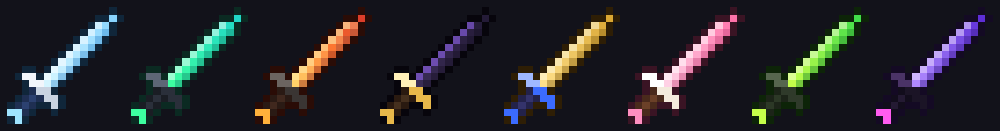
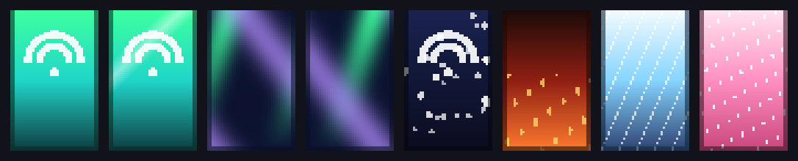

# Halcyon Visuals

Магазин визуальных дополнений для Minecraft: сайт, Fabric-мод со всеми визуалами и загрузчик, который ставит их в один клик.
Только внешний вид — без автоматизации и игровых преимуществ.




## Что внутри

| Папка | Что это | Стек |
|---|---|---|
| [`site/`](site) | Сайт-магазин: главная, каталог, страница товара, конструктор HUD, корзина, кабинет, админка, changelog | HTML, Tailwind CSS, ванильный JS, hash-роутер |
| [`mod/`](mod) | Мод Halcyon Visuals для Minecraft 1.21.1 | Java 21, Fabric, Mixin |
| [`loader/`](loader) | Halcyon Loader — установщик для Windows (`.exe` с Java внутри) | Java 21, Swing, jpackage |
| [`docs/`](docs) | Кейс для портфолио и сценарий видео | Markdown |

## Возможности мода (0.8.0)

- **HUD:** 13 элементов на привязках к краям экрана, вотермарка, список визуалов, уведомления, редактор расположения.
- **Меню на правый Shift:** 9 вкладок, все изменения видны сразу.
- **Косметика:** 8 скинов мечей (3 анимированных), 6 плащей в 4× разрешении, 3 скина удочки, аура.
- **Бой:** частицы попаданий, цифры урона, эффект убийства, цвет вспышки урона, прицелы, обводка блока.
- **Интерфейс:** стеклянные окна, подсказки, главное меню и экраны загрузки, скриншот без HUD.
- **Мир:** темы неба и тумана, погода, изумрудный блеск, сияние редкого лута.
- **Буст FPS:** пресеты графики с возвратом, установка Sodium, Lithium, FerriteCore.

## Сборка

Нужен JDK 21.

```bash
cd mod && ./gradlew build                       # мод: mod/build/libs/halcyon-visuals-0.8.0.jar
cd mod && ./gradlew runClient                   # запуск игры с модом для проверки
cd loader && ./gradlew jar                      # загрузчик со встроенным модом: loader/build/libs/HalcyonLoader.jar
jpackage --type app-image --input loader/build/libs --main-jar HalcyonLoader.jar \
  --main-class dev.halcyon.loader.HalcyonLoader --name "Halcyon Loader" \
  --add-modules java.base,java.desktop,java.net.http,java.logging,java.sql,jdk.crypto.ec,jdk.localedata
```

Сайт — статический: откройте `site/index.html` или выложите папку на любой хостинг.

Текстуры скинов генерируются кодом: `mod/tools/*.java` (`java mod/tools/SwordGen.java mod/src/main/resources/assets/halcyon`).

## Ограничения

- Мод работает на Minecraft 1.21.1 (Fabric).
- Косметика клиентская: её видите только вы.
- Оплата на сайте демонстрационная — платёжный провайдер подключается в `site/js/integrations.js`.

## Как сделан проект

Спроектирован и собран с помощью ИИ-ассистента (Claude). Подробнее — в [docs/case-study.md](docs/case-study.md).
